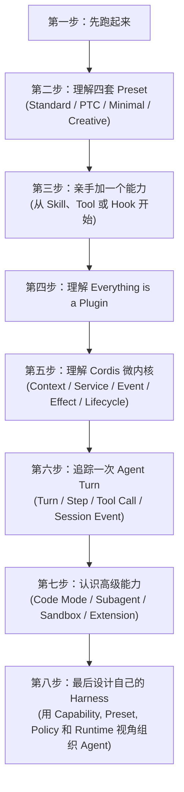

欢迎来到 **DeepSeek Harness（DSH）入门学习笔记**。

本项目基于 Datawhale 开源组队学习课程 **《DeepSeek Harness 技术入门与架构原理》**，系统性记录从“模型认知”到“Agent Runtime 架构”，再到“自研 Harness 设计”的完整学习历程。

---

## 🗺️ 学习路径一览（8 步闭环）

根据教材导读规划，我们将沿着以下路线逐步深入：

---

## 📑 任务笔记目录

| 任务 | 章节主题 | 核心要点 | 笔记链接 |
| :--- | :--- | :--- | :--- |
| **Task 1** | **DeepSeek Harness 是什么？** | 剖析 Model 与 Agent 矛盾、马具隐喻、一切皆插件、4 套 Preset、稳定与易变边界 | [进入阅读 Task 1 笔记](/task1-what-is-dsh) |
| **Task 2** | **从零运行 DeepSeek Harness** | 环境搭建、Workspace 现实边界、接入模型、4 套 Preset 对照实验、Benchmark 选取逻辑 | [进入阅读 Task 2 笔记](/task2-running-dsh) |

---

## 💡 为什么要学习 Harness？

* **摆脱玩具级思维**：不再满足于简单的 $Agent = Model + Tools$，深入理解生产级环境下的上下文修剪、权限审批、状态恢复与单调防死循环保护。
* **掌握架构微内核**：学习 DSH 如何使用面向能力（Capability）的依赖反转，让大模型应用像装配积木一样灵活插拔。
