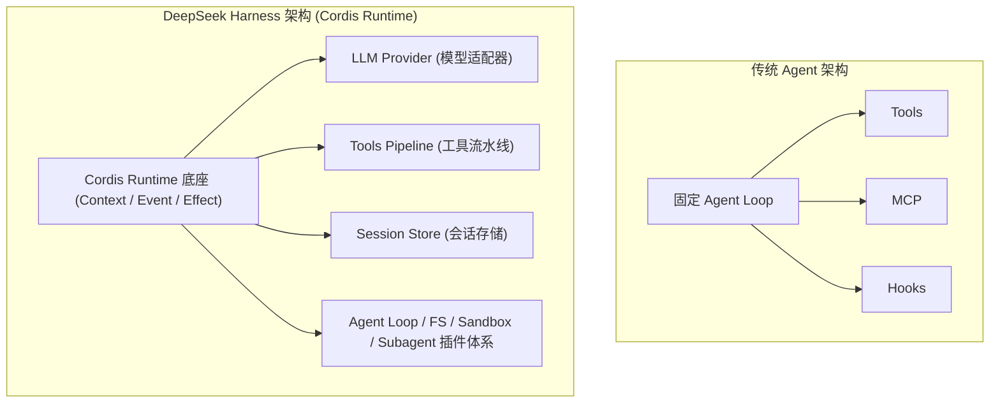

> 对应教程：**《DeepSeek Harness 技术入门与架构原理》导读 & 第 1 章（P16 - P25）**  
> 任务来源：Datawhale AI 学习中心

---

## 🎯 学习目标

学完本 Task，咱们的基础目标是能够：
1. **说清 Model 与 Agent 系统的根本矛盾**：“模型只生成 Token，Agent 要完成任务”。
2. **用自己的话解释 Harness 是什么**、它位于模型与外部世界之间的哪个位置。
3. **区分“产品”与“Runtime”**、“注册几个 Tool”与“开放 Tool 所在的运行机制”。
4. **了解 4 套 Preset**（Standard / PTC / Minimal / Creative）。
5. **理解 Developer Preview 意味着什么**：哪些东西稳定、哪些东西易变。

---

## 💡 通俗极简理解：野马、马具与马车

如果你第一次接触 Agent 底层架构，可以用生活中的**“野马与马车”**来理解：

```
+--------------------+        +---------------------+        +--------------------+
|   Model (大模型)   | -----> |   Harness (马具系统) | -----> |  External World   |
|  千里野马，输出Token| 引导与约束 |   缰绳/马鞍/安全带   | 工具与执行 |  现实代码/终端/网络 |
+--------------------+        +---------------------+        +--------------------+
```

* **大模型（Model）是一匹“千里野马”**：它的爆发力极强（掌握海量知识、具备逻辑推理），但它的本职**只是根据概率不断猜测并生成下一个词（Token）**。它没有物理实体，不知道怎么点外卖、怎么保存文件、什么是高危误删命令。
* **现实任务是一辆“大马车”**：写代码、改 Bug、跑测试、部署上线……这些需要实实在在、安全闭环地在真实世界执行。
* **Harness 就是套在马身上的整套“马具系统”**（Harness 英文原意就是马具、挽具、安全带）：
  * **戴上缰绳**（权限与安全拦截）：防止野马胡乱踩油门执行 `rm -rf /`；
  * **装上马鞍**（上下文与会话管理）：给模型稳定的骑手坐席与记忆；
  * **系上车辕**（连接工具与沙箱）：把模型的思维转化为对终端、文件系统的真实调用；
  * **护具与校正**（错误恢复与单调防护）：任务跑偏或报错时，拉回正轨。

> **核心结论**：没有马具，野马跑得再快也拉不动马车，甚至可能掀翻车子；有了 Harness，野马的力量才能转化为可靠拉车的生产力。

---

## ⚡️ 核心矛盾：模型只生成 Token，Agent 要完成任务

在聊天窗口里，很容易给人一种错觉：“模型越来越聪明了，只要再接两个工具，不就是一个强大的 Agent 吗？”

这种常见的原型公式只有在简单的 Demo 演示中够用：
$$Agent = Model + Tools$$

但进入**真实工程项目**后，一个严肃的生产级 Agent 系统必须回答以下 **10 个硬核问题**：

1. **能看到什么上下文？**（上下文如何修剪、注入与隔离）
2. **能调用哪些工具？**（工具权限如何划分与按需加载）
3. **工具在哪里执行？**（本机环境？Docker 沙箱？远程服务器？）
4. **哪些操作需要授权？**（敏感文件修改、支付或外部网络请求如何拦截审批）
5. **失败后如何继续？**（执行报错了如何捕获并作为下一轮输入引导修复）
6. **历史状态保存在哪里？**（断网或会话中断如何持久化保存与恢复）
7. **一轮什么时候结束？**（何时判定任务完成或何时交回控制权给人类）
8. **是否允许派生子 Agent？**（复杂任务如何并发分解成子任务）
9. **是否允许运行代码？**（Code Mode 与代码动态执行策略）
10. **如何恢复、审计和调试？**（每一步调用的详细日志与回溯）

因此，真实的 Agent 系统公式是：

$$Agent\ System = Model + Context + Tools + State + Loop + Execution\ Environment + Policy + Persistence + Observability$$

**Harness 的核心职责**：连接模型与外部世界（External World），并**约束**模型能做什么、怎样做以及留下什么状态。

---

## 🏗 架构对比：传统 Agent vs DeepSeek Harness



### 传统 Agent 的局限
传统的 Agent 往往是一个写死的铁盒子：固定的死循环（`while not done`）、硬编码的几个工具，如果想换个执行环境、想在工具执行前后加安全审计，往往需要大改核心代码。

### DSH 的解法：面向 Runtime 与微内核化
DeepSeek Harness 引入了基于 **Cordis** 的组合语义（Context / Event / Effect / Lifecycle）：
* **产品 vs Runtime**：从界面看，它像一个类似 Claude Engineer / Cursor 的代码助手；但从架构看，它把能力变成了**装配问题**。
* **“一切皆插件”（Everything is a Plugin）**：
  * 模型适配器是插件；
  * 工具流水线是插件；
  * 会话记录是插件；
  * 甚至连 Agent Loop 本身也是可替换的插件！

---

## 🧩 核心设计深度剖析

### 1. “一切皆插件”不等于没有核心
“一切皆插件”并不意味着可以随意乱删。它的本质是**统一了系统各个功能组件的组织方式与生命周期**：
* 上层工具只声明依赖**“文件系统能力（Capability）”**，而不关心具体由谁实现；
* 底层可以根据当前环境动态提供：`Local FS`（本地）、`Remote FS`（远程 SSH）或 `Container FS`（容器隔离）。

### 2. 为什么这不只是“多加几个 Tool”？
普通的框架只开放 `registerTool()`。但 DSH 开放了**围绕工具运行的整套生命周期机制**：
* **工具注册（Tool Registration）**
* **执行前拦截（`tools/pre-execute`）**：在真实命令下发前进行白名单、安全策略检查；
* **单调防护（Monotonic Guard）**：防止模型陷入无限死循环或倒退重复调用；
* **执行包装器（Execution Wrapper）**：自动收集执行时间、环境上下文、错误捕获；
* **后置处理（Post-Processing）**：截断超长日志、脱敏敏感信息；
* **UI 对会话事件的渲染（Session Event Rendering）**；
* **后续跟进与行为指导（Follow-up / Steer）**。

### 3. 四套预置 Preset 的实际功能与定位

在教材 P21 中，作者指出：“在许多框架中，按会话组合不同能力意味着要维护多套配置甚至多套 Loop”，而 DSH 预置的 4 套 Preset 正是对应了 4 类典型工程场景的装配实践：

* **`Standard`（标准全功能模式）**
  * **对应原文**：“一个会话可能需要完整文件系统工具、Shell、Skills（技能集）、Plan（任务规划器）、Subagent（子代理）、Workflow（工作流）、Sandbox（沙箱）和 Approval（审批）。”
  * **实际功能**：开箱即用的主力全功能 Coding Agent，拥有最全的工具链、多步骤规划、安全审批与子代理派生能力。
  * **适用场景**：日常主流软件开发、复杂需求实现与端到端故障排查。

* **`PTC`（Programmatic Tool Calling / 程序化工具调用模式）**
  * **实际功能**：**PTC 即 Programmatic Tool Calling（程序化工具调用）**，也就是 DSH 的 **Code Mode**。传统 Agent 每次调用工具都要与模型来回往返（Model -> Tool Call -> Result -> Model），耗时且浪费 Token；而在 PTC 模式下，工具被包装为 SDK，模型可以直接输出一段 **TypeScript 脚本**，在脚本中通过循环、条件判断与并发一次性编排并执行多步工具调用。
  * **适用场景**：批量文件处理、复杂逻辑编排与需要高性能低延迟的数据流水线操作。

* **`Minimal`（极简纯粹模式）**
  * **对应原文**：“另一个会话可能只需要 Bash、一个文件编辑器和固定 Prompt（提示词）。”
  * **实际功能**：大幅精简的轻量化环境，严格约束 Agent **仅拥有 Bash Shell 与文件编辑器（`str_replace_editor`）两个基础工具**，配备单行极简 System Prompt，且不启用复杂的上下文自动压缩与外部插件。
  * **适用场景**：轻量文本/代码修补、确定性脚本自动化、基准评估（Benchmark Eval），避免框架附加机制对大模型原始表现的干扰。

* **`Creative`（元开发 / Cordis 自省模式）**
  * **对应原文**：“其他会话可能还需要检查当前 Runtime、临时挂载插件或修改自己的 Preset。”
  * **实际功能**：面向 DSH 本身架构演进的**元开发（Meta-Development）模式**。在 Standard 的基础上注入了 **Cordis 运行时自省工具**，允许 Agent 自行检视当前的插件树、动态挂载/卸载插件、热重载配置，甚至编写或调试自定义 Preset。
  * **适用场景**：DeepSeek Harness 本身的二次开发、插件编写、架构调试与定制新 Preset。

### 4. Developer Preview（开发者预览期意味着什么？）
教材指明，当前 DSH 项目技术冻结在提交 `b150a551b8d465e31e418e1b2eaf5e79bbb7d28e`。
* **稳定部分（架构语义）**：Harness 的定位职责、插件组合方式、Context/Service 机制、Agent Loop 与 Tool Pipeline 契约、Sandbox/Approval 边界。
* **易变部分（版本敏感）**：CLI 命令参数、npm package 名称、Preset 目录路径、前端 UI 样式、内部事件名称、Extension API 签名等。


