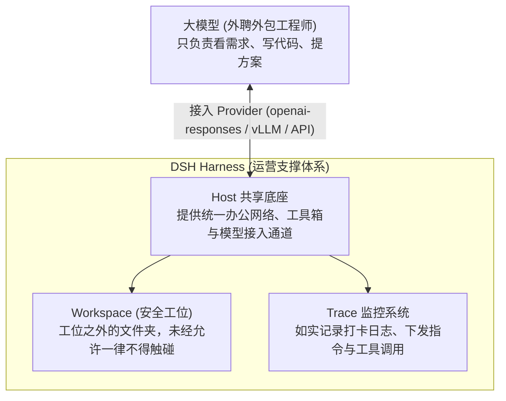
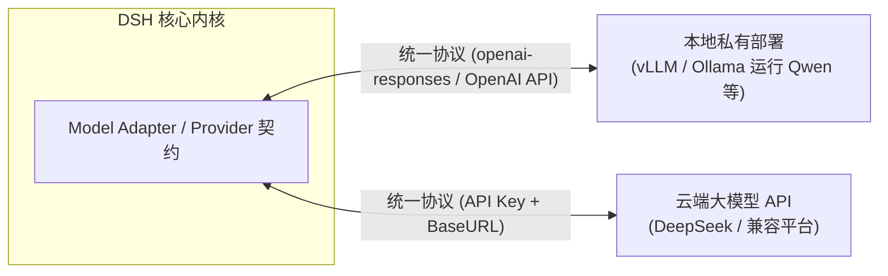
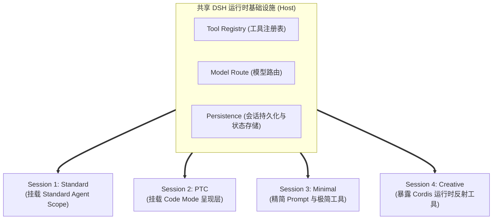

## 🎯 学习目标

学完本 Task，我们需要达成以下核心目标：
1. **环境准备与安全跑通**：掌握 DSH 运行环境搭建（Node.js ≥22.19，`npx @deepseek-ai/dsh web` 启动 3080 端口），并在独立的空目录中构建安全意识；
2. **理解 Workspace（现实世界）**：理解工作区不仅是文件夹，更是限制 Agent 观察、编辑与执行的真实物理世界；
3. **模型解耦与 Provider 接入**：理解 DSH 是 Harness 而非固定模型绑定，掌握通过统一协议（OpenAI 兼容 / openai-responses）接入本地或云端模型；
4. **4 套 Preset 对照实验与 Trace 取证**：
   * **实验 1（能力对照）**：通过 Trace（轨迹）系统而非模型自述，科学验证各 Preset 实际注入的 Tool 与能力差异；
   * **实验 2（执行轨迹差分）**：观察同一任务在不同 Preset 结构下的执行步骤、工具调用形式与性能差异；
5. **区分 Model Benchmark 与 Agent Benchmark**：搞懂官方基准测试为什么偏偏选择 Minimal 模式。

---

## 💡 通俗极简理解：工位、外聘员工与四种工作模式

为了让初学者不再被概念绕晕，我们用一个“软件外包项目组”来打个形象比方：



1. **大模型（Model）是“外聘工程师”**：它擅长思考和写字，但本身并不能直接触碰现实。
2. **Workspace 是“安全隔离工位”**：你必须给工程师划分一个专属的工作目录（`dsh-lab`）。在这个工位里，他可以随意建文件、删文件、跑命令；但**工位之外的系统核心文件，绝对不能让他随意乱翻**。
3. **Preset 是“四种工作模式”**：同一个外聘工程师，在不同的项目阶段，你可以给他戴上不同的“工作权限胸牌”：
   * **Standard（全功能正职）**：配齐终端、文件编辑、网络搜索、任务规划和子智能体，火力全开；
   * **PTC（高效代码编排岗）**：工具一样不少，但要求他“写出一段连续执行的脚本”，批量把活干完，不来回磨洋工；
   * **Minimal（硬核极简实训）**：收走所有高级辅助工具，只留最基础的命令行与文本替换器，测试其原始硬实力；
   * **Creative（自研拓展架构师）**：除了干活，还允许他修改团队制度、编写并热插拔新插件。

---

## 🛠️ 第一步：环境准备与 Workspace 安全边界

### 1. 运行环境配置
DSH 依赖现代 JavaScript 全栈运行时，官方推荐配置要求：
* **Node.js**：`^22.19.0 || >=24.0.0`
* **包管理器**：`pnpm >= 11.7.0`
* **启动方式**：
  * **快速体验（NPM 官方包）**：
    ```bash
    npx @deepseek-ai/dsh web
    # 默认通过浏览器访问 http://127.0.0.1:3080
    ```
  * **源码编译方式（用于深入研究与冻结版本复现）**：
    ```bash
    git clone https://github.com/deepseek-ai/deepseek-harness.git
    cd deepseek-harness
    git checkout b150a551b8d465e31e418e1b2eaf5e79bbb7d28e
    pnpm install
    pnpm run build
    pnpm dsh web
    ```

### 2. Workspace：Agent 的“物理现实”与安全防线
在 DSH 的 Web UI 中，进入对话前的第一步**必须指定 Workspace**。

> [!IMPORTANT]
> **新手安全铁律：永远先在空目录中开始实验！**  
> Agent 具备真实的文件读写和终端命令执行权限。如果初学者直接将生产项目的根目录或个人电脑的主目录设为 Workspace，一旦模型对指令理解产生偏差，执行了不可逆的破坏性命令（如危险的覆盖重写或删除），后果不堪设想。  
> 
> **正确习惯**：
> ```bash
> mkdir dsh-lab
> cd dsh-lab
> ```
> 始终在随时可删除、低价值的空目录中观察 Agent 的 Tool 调用和权限边界，逐步验证安全后再扩大操作范围。

Workspace 决定了：
* Agent 能够检索和观察哪些文件；
* Agent 允许修改写入哪些文件；
* Shell 终端默认在哪个路径下执行；
* 会话上下文（Context）如何建立当前工作语境。

---

## 🔌 第二步：配置与解耦模型（Model as an External Capability）

DSH 架构的一大核心哲学在于：**模型不属于 DSH 本体，而是 Runtime 可接入、可替换的一项外部能力**。



* **统一接入协议**：无论是本地使用 vLLM 部署的大语言模型，还是云端商用 API，只要遵循 `openai-responses` 或兼容的标准协议，都可以通过 Web UI **“设置 → 模型 → 添加自定义提供方”** 轻松接入；
* **固定变量原则**：在做系统架构或 Preset 对照实验时，**务必保持模型和参数固定**，这样才能准确观察不同 Preset、Context 修剪策略对 Agent 执行表现的纯粹影响。

---

## 🔬 第三步：4 套 Preset 的对照实验与 Trace 取证

### 1. 为什么“模型自述”不可信？必须用 Trace 取证！
很多初学者在测试 Agent 能力时，喜欢直接给模型发一句话：“*请问你现在具备哪些能力？*”

> [!WARNING]
> **切勿把模型的自我回答当做客观事实！**  
> 大模型本质是语言概率生成模型。当它回答自己的能力时，它只是根据过往训练数据或片段记忆在进行文本续写：它可能遗漏掉已经注册的高级工具，也可能虚构出当前根本没有挂载的“超能力”。

**科学的做法是看 Trace（轨迹观测系统）**：
* 在 DSH 的 Web 界面中点击 **Trace** 入口；
* 检查底层真正注入的 **Initial System Prompt**；
* 检查实际挂载给模型的 **Tools 列表与 JSON Schema**；
* 检查会话的 **Agent Scope（作用域）** 中到底注入了哪些服务。

---

### 2. 实验 1：4 套 Preset 的能力暴露差异对比

在相同的模型和空目录下，分别创建 4 个 Session，观察 Trace 中呈现的本质差异：

| Preset 模式 | 官方目录 | 面向模型的工具呈现 (Model-facing Tools) | 上下文与 Prompt 特点 | 适用场景 |
| :--- | :--- | :--- | :--- | :--- |
| **Standard (标准模式)** | `standard/` | 完整的标准工具集合（读写文件、终端 Bash、搜索、任务切分等） | 标准完整的系统提示词，包含工作流与规范引导 | 最常用的日常主力 Coding Agent |
| **PTC (代码编排模式)** | `code/` | **Code Mode SDK**（将所有原子工具作为 TypeScript API 暴露） | 引导模型生成一段可执行脚本编排多步操作 | 长链路、多文件批量重构任务 |
| **Minimal (极简模式)** | `minimal/` | 仅保留持久化 Bash 与文本替换编辑器（`str_replace_editor`） | 极简 Prompt，剥离了规划、搜索、子智能体等提示 | 基准测试（Benchmark）、对照实验 |
| **Creative (创造模式)** | `cordis/` | 在 Standard 基础上，额外暴露 Cordis 运行时检查与动态插件编写工具 | 增加 Cordis 微内核扩展与组合创作指导 | 高级定制、插件自研与元开发调试 |

---

### 3. 实验 2：同一任务的“执行轨迹差分”

给 4 个 Session 发送完全相同的指令：
> *“读取当前目录，创建 3 个文本文件，统计总行数，然后给出摘要。除完成任务外，不做额外修改。”*

#### 关键观察维度：
1. **网络往返次数（Request Turns）**：
   * **Standard 模式**：通常经历多轮循环——第 1 轮查目录，第 2 轮写文件 A，第 3 轮写文件 B，第 4 轮写文件 C，第 5 轮跑命令算行数，耗费多次 Token 上下文通信；
   * **PTC 模式**：模型直接生成一段 TypeScript 脚本，一次性调用本地 FS API 完成创建与统计，仅需极少的会话轮次；
   * **Minimal 模式**：直接调用 Bash 终端命令（如 `cat <<EOF` 与 `wc -l`）完成任务，路径最直白原始。
2. **工具调用形态差异**：
   * Standard 走结构化 Tool Call；PTC 走代码分发执行沙箱；Minimal 走纯终端命令。

---

## 📐 深度洞察：4 套 Preset 揭示的 3 个架构设计边界

原书通过图 2-6 和文字，深刻揭示了现代生产级 Agent 系统的三大核心设计边界：



### 边界 1：能力是否存在 vs 能力如何呈现给模型（PTC 的精髓）
* PTC 并没有把文件读写和终端命令重写一遍，底层调用的依然是相同的核心能力；
* 改变的是 **Model-facing Presentation（面向模型的呈现状态）**。Harness 既决定模型“可以使用什么”，更决定模型“以何种形式看到与调用这些能力”。

### 边界 2：Preset 不只是 System Prompt
* Preset 绝不仅仅是换一段 Prompt 那么浅薄；
* 它是一个立体的**组合贡献（Composition Contribution）**，能够同时控制 Persona、Prompt Section、Tools 注册表、Agent 本地 Service 以及特定的 Runtime 拦截机制。

### 边界 3：同一 Host 下的独立 Agent Scope
* 并不是为每个新 Session 都重新复制一套庞大的插件系统；
* **Host 先提供一套公共共享的基础设施**（模型路由、工具注册中心、持久化存储）；
* **各个 Session 再通过自己的 Agent Scope 挂载相应的 Preset 贡献**，实现轻量级、相互隔离的多模式并存。

---

## 🏆 为什么官方 Benchmark 会选 Minimal 模式？

教材第 2.5 节给出了一个极为关键的行业洞见：在官方基准测试 `BENCHMARK.md` 中，DSH 采用的是 Python SDK 的 **Minimal variant（极简变体）**。

### 1. 区分 Model Benchmark 与 Agent Benchmark
* **Model Benchmark（模型基准）**：评估大模型自身的语言推理与原生代码编写能力；
* **Agent Benchmark（智能体基准）**：评估“模型 + 整个 Harness 运行支架”这一整体系统的工程实战表现。

### 2. 为什么选 Minimal？（控制变量）
* 在 Standard 模式下，系统加入了 Skills、Planner 任务规划器、Subagent 子智能体以及动态 Context 修剪；
* **变量越多，归因越困难**：如果一个任务执行失败了，究竟是因为“模型智商不够”，还是因为“Planner 生成的引导提示词误导了模型”？又或者是“某个 Skill 插件的格式注入引发了幻觉”？
* Minimal 模式剔除了所有非必要的外置变量，只提供持久 Bash 和基础文本替换，**最大程度减少了 Harness 本身的干扰，最便于观察模型与基础工具协作的真实基线水平**。

> [!TIP]
> **架构反思**：  
> 一个模型在纯模型跑分榜上高居榜首，放进一个复杂的 Agent Runtime 中就一定表现优秀吗？**不一定！**  
> 如果该 Agent Runtime 引入了冗余的 Tool Call、过载的 System Prompt 或冗长的执行链，反而会稀释模型的有效注意力。研究 Agent，绝不能只盯着“用了什么大模型”，必须同时拷问：“**它运行在什么样的 Harness 中？它的工具管线与上下文策略是如何设计的？**”
