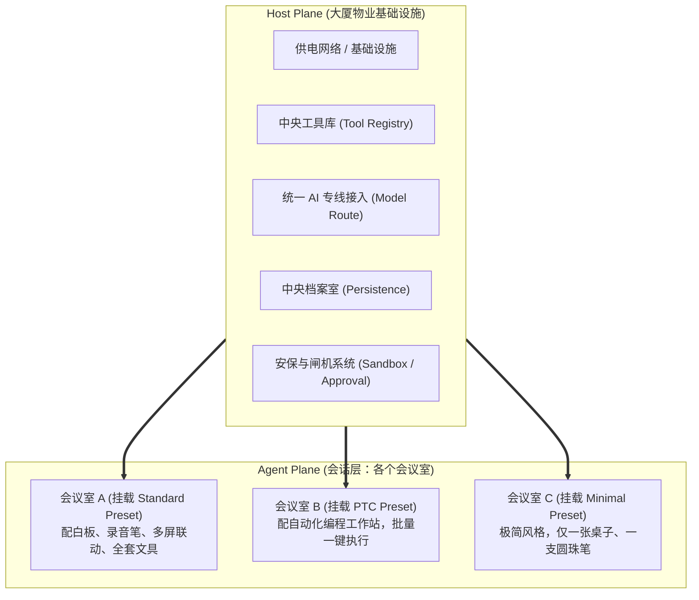
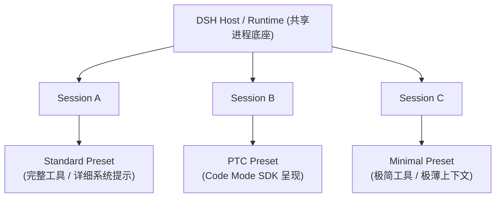
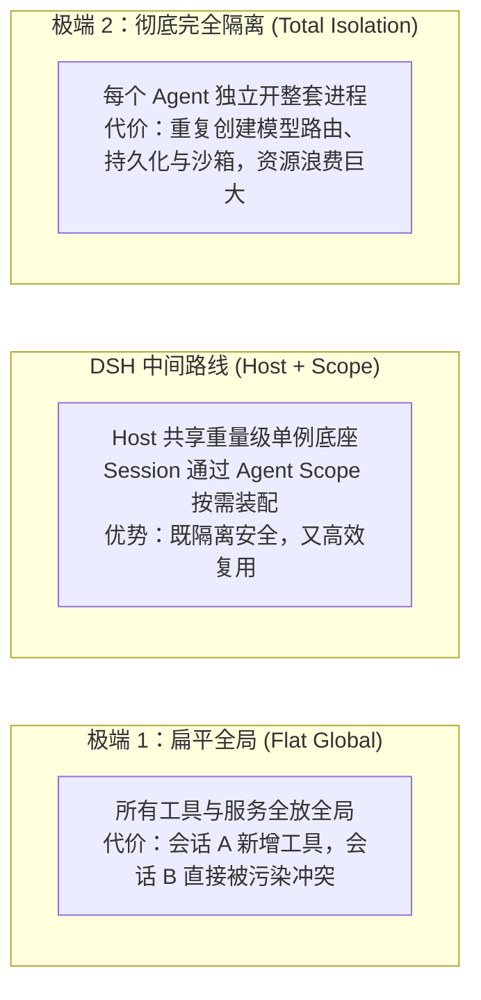
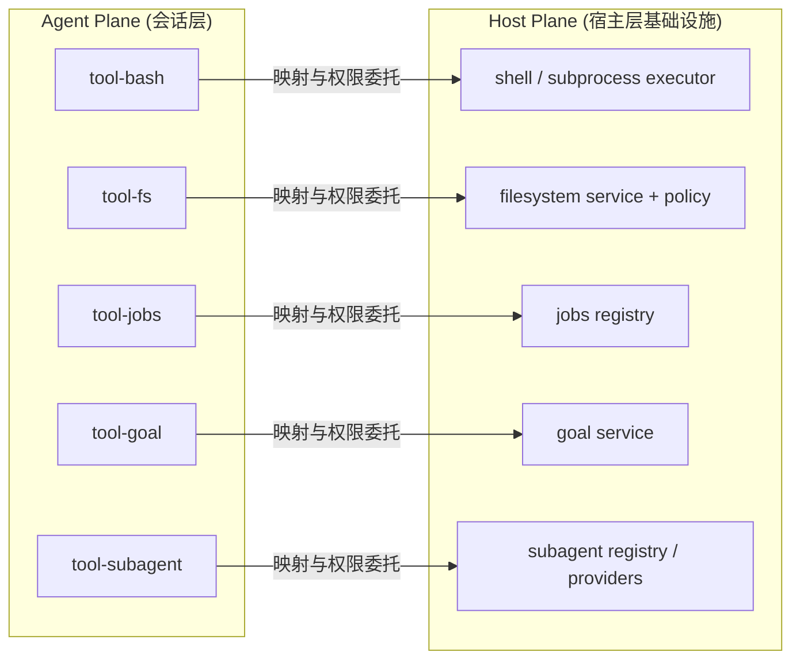
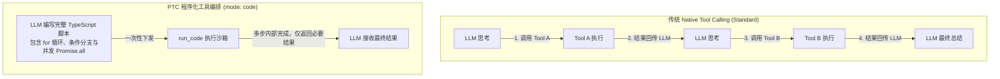

## 🎯 学习目标

学完本 Task，我们需要达成以下核心目标：
1. **打破误区**：搞清楚 4 套 Preset 绝不是 4 个独立的 Agent，而是同一套 DSH Runtime 中的 4 种能力组合；
2. **厘清 4 个核心架构概念**：准确掌握 **Preset（预设）**、**Scope（作用域）**、**Host Plane（宿主层）** 和 **Agent Plane（会话层）** 的职责边界；
3. **理解 Scope Context 的意义**：看懂会话级能力从何而来，为什么能力的动态插拔组合必须拥有清晰边界（避免两种极端）；
4. **剖析 Standard 的能力基线**：看清 Standard 的 9 大能力属于哪个作用域、由谁提供、向谁开放，搞懂“改 Agent Plane”与“改 Host Plane”的本质区别；
5. **深度对比 PTC 与 Minimal**：
   * **PTC**：同一批底层能力，不同的模型呈现方式（Tool Presentation: mode: code）与网络往返（Round Trip）压缩边界；
   * **Minimal**：把 Harness 压到极薄，只保留极简工具与沙箱治理，构建纯粹的评测基线。

---

## 💡 通俗极简理解：云办公大厦与多功能会议室

为了彻底搞懂 Host Plane、Agent Plane 与 Preset，我们用一个“现代共享办公大楼”来类比：



1. **Host Plane（大厦公共基础设施）**：
   * 整栋大楼统一建设的公共服务：AI 专线（模型路由）、中央工具库（文件系统/Shell 实际驱动）、安保闸机（沙箱与执行权限）、中央档案柜（持久化）。
   * **特点**：进程内单例（Singleton），所有会议室共享，绝不需要开一间新会议室就重盖一座大厦。
2. **Agent Plane（各专属会议室）**：
   * 针对不同工作任务布置的房间环境。会议室里挂什么制度牌（Prompt）、桌上摆放哪些工具（Tool Registration）、谁来主持（Persona），全由当前会议室决定。
3. **Preset（会议室装修配置单）**：
   * 是一份“装配配方”，按需决定当前会议室挑选大楼的哪些工具、如何呈现给里面的员工。
4. **Scope（房间隔墙与权限边界）**：
   * 会议室之间的物理隔断！确保 A 房间里在白板上涂写的临时备忘录，绝对不会莫名其妙出现在 B 房间的桌上。

---

## 🏢 第一部分：Preset 绝非 4 个独立 Agent，而是同一 Runtime 下的组合

初学者很容易把 Standard、PTC、Minimal、Creative 误解为：
> ❌ *“这是 4 个完全不同的 Agent 软件，有 4 套独立的代码库和 4 个不同的执行循环（Loop）。”*

**这是严重的架构误读！**

根据 `agent.cordis.yml` 架构设计：
* **Host 统一常驻一套共享基础设施**：负责管理模型连接、全局工具注册表、持久化存储以及沙箱拦截；
* **每个 Session（会话）进入自己的 Agent 作用域后**：才根据所选的 Preset，将对应的 Prompt、面向模型的 Tool 和特定服务挂载到会话中；
* 多个 Session 可以并发运行不同的 Preset，各自保持独立的能力组合与上下文。



---

## ⚖️ 第二部分：Host Plane vs Agent Plane，避免两种架构极端

系统设计在处理多会话能力时，最容易走向两种极端，DSH 巧妙地选择了兼顾隔离与复用的“中间路线”：



### 1. 为什么动态组合必须有 Scope（作用域）？
* **Scope 回答三个关键问题**：
  1. 这项能力究竟属于谁？
  2. 谁能够看到并调用它？
  3. 它应该跟谁的生命周期一起创建和销毁？
* **隔离保护**：如果会话 A 动态加载了一个专门处理金融数据的插件，该插件只会挂载到会话 A 的 Agent Scope 下，绝对不会泄漏给正在处理日常代码的会话 B。

---

## 📐 第三部分：Standard 的能力基线剖析

Standard 是官方提供的完整编程类 Preset，包含 9 大典型能力分支：

```text
Standard
├── Persona / Instructions (人设与系统规约)
├── Filesystem (文件系统操作)
├── Shell (终端命令执行)
├── Search / Web (网页与文件检索)
├── Skills (动态专业技能库)
├── Plan / Goal (目标拆解与任务规划)
├── Context / Compaction (上下文构建与自动修剪)
├── Subagent (子智能体协同)
└── Workflow / Interaction (工作流与用户交互)
```

在深入阅读其架构时，不能只看“挂了多少项”，而要区分这 4 类组合项的本质与生命周期归属：

| 组合项类别 | 主要负责的任务 | 典型内容 | 生命周期与作用域归属 |
| :--- | :--- | :--- | :--- |
| **角色与提示词** | 定义 Agent 的身份人设、行为守则与上下文提示 | Persona、Prompt Section、Skill Catalog | 跟随 Agent / Preset 销毁 |
| **面向模型的工具** | 决定当前会话中，模型能在 Tools 列表中看到并调用的指令 | FS 工具、Shell 工具、Web 搜索、Subagent 等 | 跟随 Agent / Preset 销毁 |
| **会话级状态** | 保存只属于当前会话的运行时上下文与执行状态 | Plan 步骤、Goal 当前进度、Workflow 状态机 | 跟随当前 Session 独立维护 |
| **Host 能力适配项** | 将 Host 已有的共享基础设施接入当前会话 | Tool Registry、Model Route、Sandbox 拦截器 | **由 Host 统一提供，Agent 仅按需消费** |



> [!TIP]
> **经典设计考题：改 Agent Plane 还是改 Host Plane？**
> * **需求 A（业务级微调）**：“我不希望这个会话擅自修改文件，只能读取。”  
>   👉 **修改 Agent Plane**：只需在该会话的 Tool 列表中移除写入工具，或者注入一条限制 Prompt，底层文件驱动完好无损。
> * **需求 B（基础设施级安全治理）**：“所有会话的文件操作，都必须统一重定向到远程 Docker 容器或安全沙箱中执行。”  
>   👉 **修改 Host Plane**：必须替换 Host 层的 Filesystem Provider 与 Sandbox 策略驱动。这样无论是哪个会话、使用哪套 Preset，底层的真实执行动作都受到全局统一安全管控。

---

## ⚡️ 第四部分：PTC 与 Minimal 的深度对照

### 1. PTC：同一批能力，不同的呈现方式（Tool Presentation）



* **源码改动极小**：在 `code/agent.cordis.yml` 中，PTC 几乎全盘继承了 Standard 的各项基础能力，唯一的核心差异是加入了 `Tool Presentation`，将工具呈现模式配置为 `mode: code`；
* **Round Trip（网络往返）压缩**：将原来需要模型与工具之间来回打乒乓球的离散交互，压缩为由模型编写一段 TypeScript 脚本一次性在沙箱中执行；
* **边界思考：“PTC 一定比 Standard 更快更好吗？”**：
  * **不一定！** PTC 适合**确定性强、逻辑清晰的批量操作**（例如：遍历 50 个文件并按规则提取行数）；
  * 如果任务需要**根据中间结果动态调整策略**，或者模型写出的 TypeScript 代码存在语法漏洞，PTC 反而会因为脚本崩溃而需要反复调试代码，得不偿失。

---

### 2. Minimal：把 Harness 压到非常薄的“基准尺”

* **不是“残缺版”，而是“纯粹的测试标尺”**：
  * 明确设置 `includeRuntimeContext: false`；
  * 不启用上下文自动压缩修剪；
  * 剥离了 Skills、Planner、Subagent 等一切会向 Prompt 中额外灌注提示的高级能力；
  * 只保留持久化 Bash 与文本替换编辑器 `str_replace_editor`。
* **极简工具 $\neq$ 放弃底层安全治理**：
  * 虽然模型只能看到 2 个原始工具，但底层执行依然依赖 Host Plane 提供的沙箱隔离与环境约束。
  * **核心价值**：把外层“支架”的干扰降到最低，让评估者能够清晰鉴别出“大模型本体的原生硬实力”。
