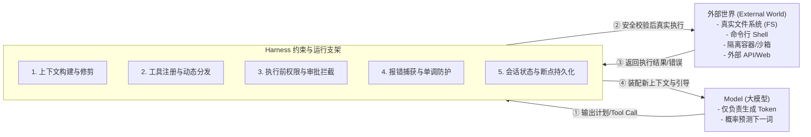

# Task 1：参考作业设计思路与课后自测解答

> 本文档用于独立归档 Task 1 的作业设计思路、课后自测题目解答以及教材图表索引，供离线复习参考，不发布到在线文档站点。

---

## ✍️ 参考作业设计思路

### 作业 A：画一张“Model → Harness → 外部世界”示意图并标注 5 个以上问题

### 作业 B：300~500 字笔记回答：“为什么 DSH 值得单独写一本书？它把什么公开得足够彻底？”

> **参考回答范文**：  
> 市场上已有数十种 Coding Agent 和 Framework，大部分都在“外层产品功能”上做文章，把 Agent 当成“模型加几个 API 调用”的黑盒包装。  
> 
> DSH（DeepSeek Harness）之所以值得单独写一本书，是因为它**把聚光灯打在了一直被同行隐藏在暗处的“Agent Runtime（运行机制）”上**。它公开得足够彻底的地方在于：
> 1. **公开了能力的装配机制**：不再将文件操作、命令行执行与业务绑定，而是抽象为 Cordis 体系下的能力插槽，实现了“Everything is a Plugin”；
> 2. **公开了 Tool 周围的护栏与流程**：从执行前的权限拦截、单调防循环保护，到执行中的沙箱隔离与执行后的状态渲染，完整呈现了一个生产级 Agent 该如何安全可靠地与现实世界交互；
> 3. **区分了产品与运行时**：告诉开发者如何基于一套稳定的微内核底座，随心装配出满足不同场景的 Preset。它不仅是一个能用的工具，更是 Agent 架构演进的一套经典参考范式。

---

## ❓ 课后自测题参考解答

### Q1：Harness 一词的原意是什么？为什么贴切？
* **解答**：Harness 原意是**马具**（马鞍、笼头、缰绳），也指**安全吊带/挽具**。这个比喻极为贴切：大模型能力再强，也只是一匹擅长文字生成的“野马”；没有马具，它既拉不动真实世界的马车（无法完成实际任务），还容易失控狂奔（误删数据、安全失控）。Harness 正是那套让野马能够安全、受控、持续拉车的控制系统。

### Q2：“一切皆插件”和“多加几个 Tool”的区别在哪里？
* **解答**：“多加几个 Tool”只是一维的累加，仅仅是在一个固定写死的执行循环（Loop）里塞入几个函数，无法应对复杂权限、跨平台沙箱或环境变化；而“一切皆插件”是**架构维度的解耦**，不仅工具是插件，连模型适配器、会话存储、权限策略甚至 Agent Loop 本身都是遵循统一生命周期契约的可插拔组件，系统依赖的是“能力契约”而非“具体实现”。

### Q3：DSH 中哪些部分是稳定的架构语义，哪些是版本敏感的？
* **解答**：
  * **稳定部分（核心理念与架构语义）**：Harness 连接并约束模型的定位、基于 Cordis 的上下文与生命周期管理机制、Tool 执行管线、Sandbox 审批边界等；
  * **版本敏感部分（具体实现细节）**：具体的命令行 CLI 参数、NPM 模块名称、Preset 文件夹路径、具体的函数 API 签名与 UI 事件名等。

---

## 📚 教程原版教材图表归档（P16 - P25）

为了方便随时对照原书复习，以下整理了本 Task 对应的 10 页教材图示：

| 章节与页码 | 内容概要 | 对应文件 |
| :--- | :--- | :--- |
| **P16（导读）** | Model 与 Agent 矛盾，系统需回答的 10 个问题 | `public/images/page_0016.png` |
| **P17（导读）** | 生产系统公式，为什么 DSH 值得单独写一本书 | `public/images/page_0017.png` |
| **P18（导读）** | 图 0-1 架构对比图，图 0-2 Harness 位于模型与外部之间 | `public/images/page_0018.png` |
| **P19（导读）** | 图 0-3 八步学习路径，每个阶段回答的问题 | `public/images/page_0019.png` |
| **P20（导读）** | 图 0-4 Harness Lab 最终概念架构图 | `public/images/page_0020.png` |
| **P21（第 1 章）** | 1.1 产品 vs Runtime，预置 4 套 Preset 介绍 | `public/images/page_0021.png` |
| **P22（第 1 章）** | 1.2 “一切皆插件”详解，面向能力的依赖解耦 | `public/images/page_0022.png` |
| **P23（第 1 章）** | 1.3 为什么不只是多加几个 Tool，Tool Pipeline 扩展点 | `public/images/page_0023.png` |
| **P24（第 1 章）** | 1.4 是否意味着行业标准，1.5 Developer Preview 定位 | `public/images/page_0024.png` |
| **P25（第 1 章）** | 稳定架构语义 vs 版本易变细节边界说明 | `public/images/page_0025.png` |
