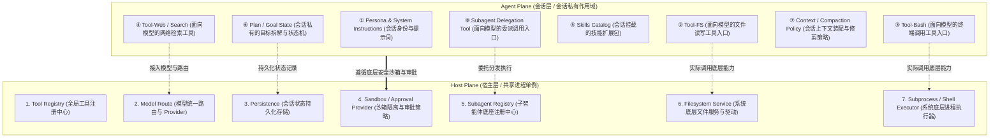

# Task 3：参考作业设计思路与课后自测解答

> 本文档用于独立归档 Task 3 的作业设计思路、分层架构示意、课后自测题解答以及教材图表索引，供离线复习参考，不发布到在线文档站点。

---

## ✍️ 参考作业设计思路

### 作业 A：Host Plane / Agent Plane 双层架构分层图

> **设计要求**：画一张 Host Plane 与 Agent Plane 的分层图，并把 Standard 的至少 8 项典型能力准确标注在对应的层级与作用域中。

---

### 作业 B：用生活/工程例子说明“改 Agent Plane”与“改 Host Plane”是两类不同需求

> **题目要求**：仿照书中“禁用写文件工具 vs 所有文件操作进远程容器”，结合自己的开发或业务场景，给出两类不同需求的典型实例。

#### 示例 1：数据库交互场景（只读查询 vs 统一审计防火墙）
* **需求 1（改 Agent Plane）**：“在这个会话中，要求 Agent 只能帮我分析报表，不允许执行任何增删改 SQL。”  
  👉 **处理方式**：在 Agent 会话配置中，只暴露 `read_query` 工具，不向模型提供 `execute_dml` 工具，并注入“你是一个只读分析助手”的 Persona。底层数据库驱动保持不变。
* **需求 2（改 Host Plane）**：“为了满足企业安全合规要求，所有 Agent 发起的所有 SQL 查询必须经过脱敏代理服务，且记录不可篡改的日志。”  
  👉 **处理方式**：在 Host 层修改 Database Provider 驱动，将所有发往数据库的连接强制走公司的合规代理沙箱。无论上层哪套会话、哪个 Prompt，都无法绕过这一底层拦截。

#### 示例 2：代码开发场景（禁止调用 Git Push vs 所有代码在隔离 Docker 跑）
* **需求 1（改 Agent Plane）**：“实习模式下，当前会话不要让模型自作主张执行 `git push`。”  
  👉 **处理方式**：在 Agent Plane 中移除 git push 工具或在会话级拦截器中拦截该指令，属于会话角色与权限的微调。
* **需求 2（改 Host Plane）**：“防止模型写出恶意脚本破坏开发者本机的开发环境，要求所有终端命令必须跑在由 Docker 动态拉起的轻量容器中。”  
  👉 **处理方式**：在 Host 层的 `subprocess executor` 中接入 Docker API，直接替换命令执行器的底层实现。

---

## ❓ 课后自测题参考解答

### Q1：DSH 的分层避免了哪两种极端？各自代价是什么？
* **解答**：
  1. **极端一：扁平全局模式（Flat Global）**  
     * **做法**：把所有工具、提示词与会话服务一股脑丢进全局命名空间。  
     * **代价**：隔离性彻底破裂。会话 A 动态安装了一个插件或改动了某项设置，会直接污染到正在运行的会话 B；极易引发同名服务冲突、上下文污染和安全越权。
  2. **极端二：彻底完全隔离模式（Total Isolation）**  
     * **做法**：为每个新打开的对话（Session）完全独立克隆/启动一套全新的后台进程与基础设施。  
     * **代价**：资源开销与启动延迟极为昂贵。每个会话都要重复创建模型路由连接、文件索引缓存、沙箱容器与持久化连接，系统难以承载多会话并发，且无法进行全局统一的策略审计治理。
  * **DSH 的解法**：Host 层持有单例共享底座，Agent Scope 负责会话级轻量组合，兼顾了资源复用与会话安全隔离。

### Q2：“会话 A 新增的 Tool 影响到会话 B”——问题出在哪一层？
* **解答**：  
  **问题出在“作用域（Scope）归属与注册层级”混乱，错把本该属于 Agent Plane 的局部工具注册到了 Host Plane（或全局根 Context）上**。  
  在合规的设计中，Preset 或会话动态加载的工具必须通过当前会话的 `Agent Scope Context` 注册，其可见性仅限于会话自身。如果出现在会话 B 中也能调用会话 A 工具的现象，说明该插件的注册代码直接使用了 Host 级别的全局注册表（跨过了作用域边界）。

### Q3：PTC 与 Standard 在源码层面的差异有多小？改变的是什么？
* **解答**：  
  * **差异极小**：在源码配置文件 `code/agent.cordis.yml` 中，PTC 几乎全盘复用了 Standard 预置的原有能力树（文件系统、Shell、检索等全部保留），仅仅是额外增加了一个 `Tool Presentation` 插件，并将呈现模式设置为 `mode: code`；
  * **改变的核心**：
    1. **面向模型的呈现方式（Model-facing Presentation）**：从传统的 Native Tool Calling（离散的 JSON 参数）转变为面向模型的 TypeScript SDK；
    2. **交互范式从“乒乓对话”变为“程序编排”**：允许大模型生成一段包含逻辑控制流（循环、并发、条件判断）的脚本，一次性交由 Host 提供的 `codeRuntime` 沙箱执行，大幅压缩会话往返轮次（Round Trip）。

---

## 📚 教程原版教材图表归档（P35 - P44）

| 章节与页码 | 内容概要 | 对应文件 |
| :--- | :--- | :--- |
| **P35（第 3 章）** | 3.1 Preset 不是 4 个独立 Agent，核心 4 概念引出 | `public/images/page_0035.png` |
| **P36（第 3 章）** | 图 3-1 Runtime 与 Session Preset 关系图，3.2 Host Plane 与 Agent Plane 区分 | `public/images/page_0036.png` |
| **P37（第 3 章）** | 图 3-2 职责边界，3.2.1 Scope Context 意义与避免两种极端，图 3-3 中间路线架构 | `public/images/page_0037.png` |
| **P38（第 3 章）** | 3.2.2 作用域意义（动态组合必须有边界），3.3 Standard 能力基线介绍 | `public/images/page_0038.png` |
| **P39（第 3 章）** | Standard 组合树（9 大能力），图 3-4 Preset 到 Host Plane 的能力映射 | `public/images/page_0039.png` |
| **P40（第 3 章）** | Host 与 Agent 分工原则，表 3-1 Standard 组合项分类（角色、工具、状态、Host 适配） | `public/images/page_0040.png` |
| **P41（第 3 章）** | 表 3-1 续表，改 Agent 还是改 Host 案例分析，3.4 PTC：同一批能力不同呈现方式 | `public/images/page_0041.png` |
| **P42（第 3 章）** | 图 3-5 Tool Calling 与 PTC 对比，Model-facing Presentation 与模式解耦 | `public/images/page_0042.png` |
| **P43（第 3 章）** | 图 3-6 同一工具能力不同使用方式，Round Trip 压缩与 PTC 收益边界分析 | `public/images/page_0043.png` |
| **P44（第 3 章）** | PTC 依赖 codeRuntime 及状态管理，3.5 Minimal：把 Harness 压到非常薄的意义 | `public/images/page_0044.png` |
